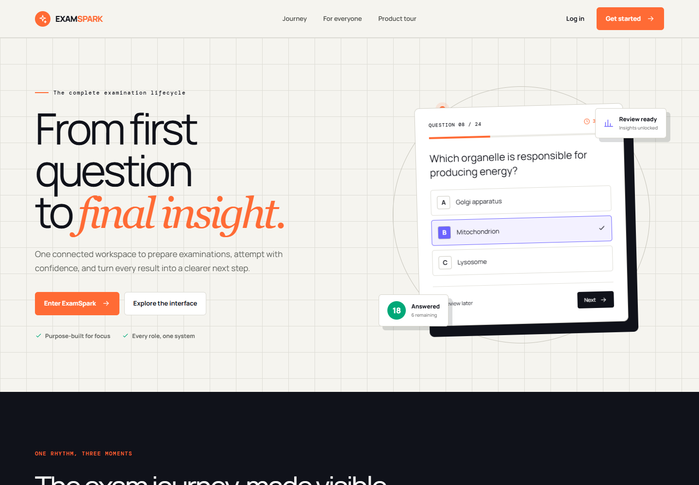
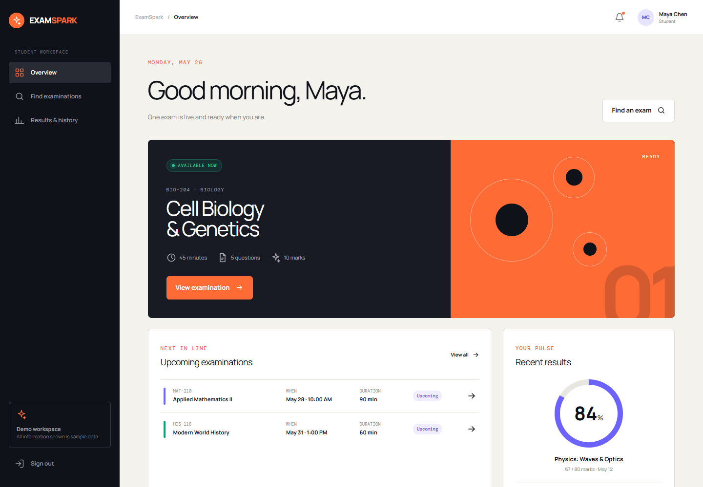
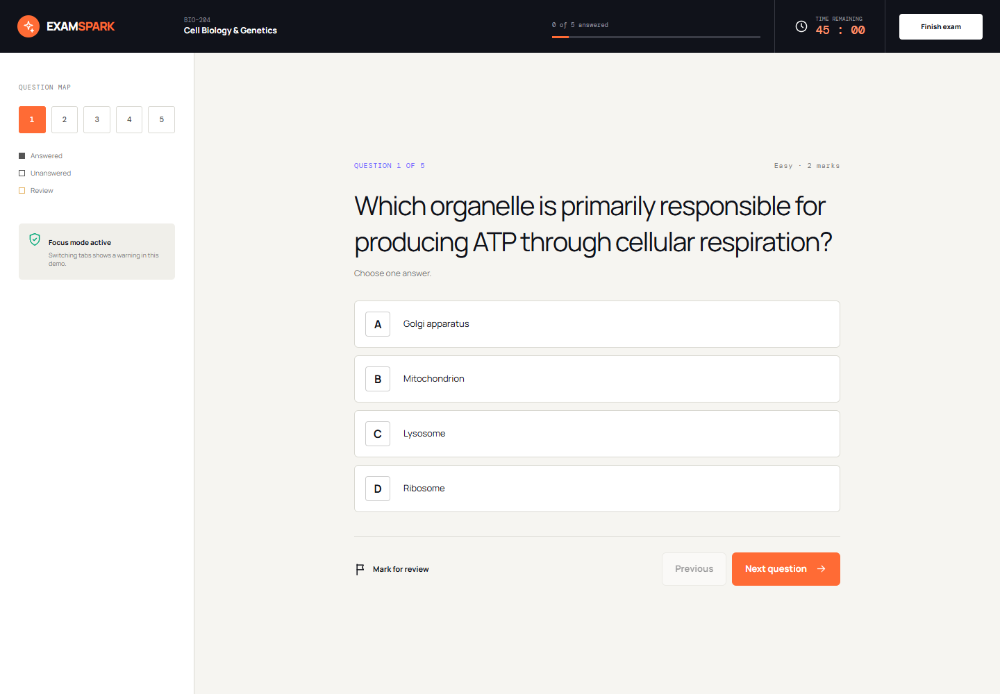
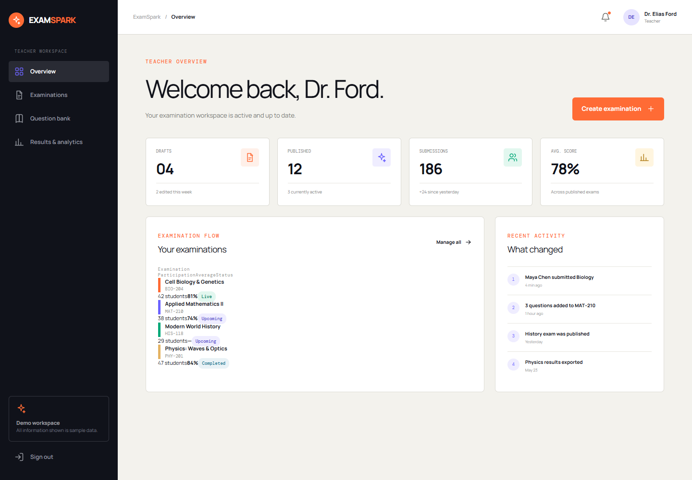
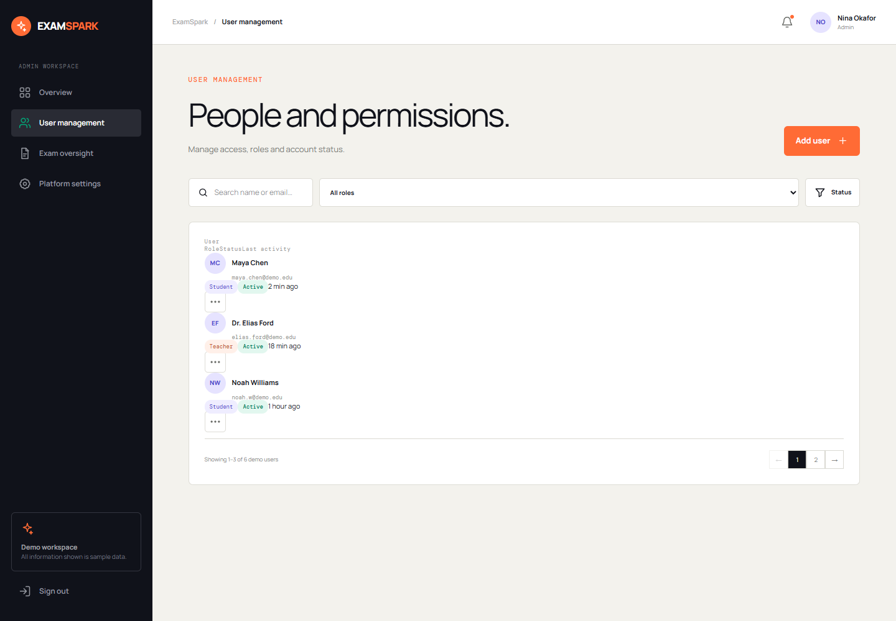

# Exam_Spark

ExamSpark is an online examination platform with a React and TypeScript frontend, an Express REST API, MySQL persistence, and Supabase Auth for email/password and Google/GitHub sign-in. Some dashboard panels still use sample data; exam, question, attempt, assignment, and account flows are connected to the API.

## Project overview

The interface illustrates an examination lifecycle: finding and preparing for an exam, completing a timed attempt, reviewing a local result, and managing examination-related views for teaching and administration. The project focuses on:

- Showing how the student, teacher, and administrator workspaces fit into one product.
- Connecting examination and management flows to a role-aware API.
- Keeping pages, shared UI, styling, and sample data organized for continued frontend work.

## Features by role

### Student

- Dashboard with a featured live exam, upcoming exams, recent-result examples, activity, and notices.
- Examination catalogue with text search by title, subject, or code and status filters.
- Study library for Database Management System, Java, Data Structures and Algorithms, Discrete Structures, Advanced Web Technologies, Operating Systems, and Computer Systems, with handbook, GeeksforGeeks, and YouTube links.
- Daily assignment to-do list with four sample tasks; checking them off updates a completion report.
- Preparation screen with examination details, instructions, and an acknowledgement before starting.
- Attempt screen with a question map, multiple-choice selection, a countdown display, review flags, and a submit dialog.
- Results view with a browser-calculated demonstration score, topic breakdown, answer review, and sample result history.

The demo catalogue includes sample questions for the computing subjects. Answers and the selected exam are held in browser memory for the current page session. The timer, answer key, score, and tab-switch warning are not authoritative examination controls. Demo assignments, exams, and questions are stored in the current browser; demo results are illustrative and are not shared with a backend.

### Teacher

- Overview dashboard with sample class performance and question difficulty analytics in demo mode; API-backed data in a configured workspace.
- Examination management with search, status filters, and API-backed or browser-local demo creation and publish/close controls.
- Question bank with search, difficulty filtering, question creation, and CSV template/import actions; demo questions are stored in the browser.
- Teacher assignments page for posting daily class tasks to the student to-do list.
- Results and analytics with question-level performance and a downloadable CSV summary.

Real exam/question records and teacher analytics require a configured API and MySQL database. The demo teacher can create and publish browser-local exams and questions, which then appear in the student demo catalogue and can be attempted and auto-scored in the browser. CSV import accepts `topic,difficulty,prompt,optionA,optionB,optionC,optionD,correctOption,explanation,points`; `correctOption` may be a letter or zero-based index.

### Administrator

- Platform overview with sample user and examination totals.
- User management with API-backed search, role/status filters, pagination, account creation, and status changes.
- Examination oversight with sample ownership and participation rows.
- Settings sections for subjects, announcements, files, audit history, and general settings; editable entries are saved in the current browser.

Overview and examination-oversight totals remain examples. Account management requires the API and MySQL; browser-saved settings are not shared with other users, and audit history remains read-only until backed by an audit service.

### Public and authentication screens

- Public homepage with product overview, role entry points, and responsive navigation.
- Sign-in and registration screens with client-side form checks, role selection for sign-in, and password visibility control.
- Sign-in and registration offer password-free demo access as Rudrakshi Sharma (student) or Dr. Elias Ford (teacher); demo access does not create an account or store a password.

Student registration and sign-in use Supabase Auth when configured. Legacy bcrypt-backed local accounts remain supported for password sign-in.

## Technology stack

- React 19 and TypeScript
- Vite 8 for development and production builds
- Tailwind CSS 4 via `@tailwindcss/vite`, with the product styling in `src/index.css`
- Express 5 API, MySQL (`mysql2`), and Supabase Auth
- Manrope and DM Mono fonts loaded from Google Fonts
- pnpm for package management

The repository pins Node.js 22 and pnpm 10.34.3 in `.mise.toml`.

## Screenshots

These screenshots were captured from the running frontend with Playwright and headless Chrome. They show sample interface data, not live records.

| Public homepage | Student workspace |
| --- | --- |
|  |  |

| Examination attempt | Teacher workspace |
| --- | --- |
|  |  |

| Administrator user management |
| --- |
|  |

## Prerequisites

- Node.js 22
- pnpm 10.34.3 (the version pinned in `.mise.toml`)

Use the repository's mise configuration or an equivalent local toolchain to select these versions.

## Installation and local setup

Copy the environment template, configure a MySQL database and Supabase project, and enable Email, Google, and GitHub providers in Supabase Auth. Set the Supabase project URL and public anon key in both the `SUPABASE_*` and `VITE_SUPABASE_*` variables in `.env`. Never use a Supabase service-role key in the frontend.

Add `http://localhost:8443/?auth=callback` as an allowed redirect URL in Supabase. Configure Google and GitHub client credentials in the Supabase provider settings and use the callback URLs displayed in the Supabase dashboard in the respective provider consoles.

```powershell
Copy-Item .env.example .env
pnpm install --frozen-lockfile
mysql -u root -p < server/schema.sql
```

Start `pnpm server:dev` and `pnpm dev` in separate terminals. Vite uses port `8443` and proxies `/api` requests to the Express API on port `3001`. Configure a random `JWT_SECRET` of at least 32 characters. If Supabase email confirmation is on, confirm your email before signing in.

To build and preview the production bundle:

```sh
pnpm run build
pnpm preview
```

## Available scripts

| Command | Purpose |
| --- | --- |
| `pnpm dev` | Start the Vite development server. |
| `pnpm server:dev` | Start the API with Node watch mode. |
| `pnpm server` | Start the Express API. |
| `pnpm bootstrap:admin` | Create the first local administrator using values from `.env`. |
| `pnpm run typecheck` | Run the TypeScript compiler without emitting files. |
| `pnpm run build` | Create the production bundle in `dist/`. |
| `pnpm preview` | Serve the previously built bundle locally. |
| `pnpm run format` | Format source files with oxfmt. |

There is no dedicated automated test script or frontend test framework in the project currently.

## Application routes

Routing is hash-based and implemented in `src/App.tsx`. Route fragments use the form `/#route` (for example, `/#student`). The homepage is the root URL without a hash.

| Area | Route |
| --- | --- |
| Public homepage | `/` |
| Sign in | `/#login` |
| Registration | `/#register` |
| Student overview | `/#student` |
| Study resources | `/#study` |
| Examination catalogue | `/#discover` |
| Personalized analysis | `/#analysis` |
| Student assignments | `/#assignments` |
| Examination preparation | `/#prepare` |
| Examination attempt | `/#attempt` |
| Results and history | `/#results` |
| Teacher overview | `/#teacher` |
| Examination management | `/#create` |
| Question bank | `/#bank` |
| Teacher assignments | `/#classwork` |
| Teacher analytics | `/#analytics` |
| Administrator overview | `/#admin` |
| User management | `/#users` |
| Examination oversight | `/#oversight` |
| Platform settings | `/#settings` |

## Project structure

```text
.
├── .figma/make/           # Figma Make setup, preview, and deployment helpers
├── public/
│   └── favicon.png        # Static favicon
├── screenshots/           # Playwright captures used in this README
├── server/
│   ├── auth.js            # Supabase/local authentication and session routes
│   ├── routes.js          # Exam, attempt, assignment, and analytics API
│   └── schema.sql         # MySQL schema
├── src/
│   ├── components/        # Shared UI, workspace shell, dialog focus behavior
│   ├── pages/             # Public, student, teacher, and admin page modules
│   ├── App.tsx            # Hash route map
│   ├── data.ts            # Sample exams, questions, and users
│   ├── index.css          # Theme, components, and responsive styles
│   ├── main.tsx           # React entry point
│   ├── state.ts           # Demo state and authenticated display profile
│   └── supabase.ts        # Supabase client and API session exchange
├── FRONTEND_INTEGRATION_GUIDE.md
├── package.json
├── pnpm-lock.yaml
├── tsconfig.json
└── vite.config.ts
```

## Architecture and demo data

`src/App.tsx` maps the supported hash routes to feature page components. Shared controls and route types are in `src/components/ui.tsx`; the role-aware sidebar, page headings, and metric cards are in `src/components/workspace.tsx`. Dialog focus handling is shared through `src/components/useDialogFocus.ts`.

Sample class and analytics records are defined in `src/data.ts`; browser-local demo exams and questions are managed in `src/demoData.ts`. The selected exam and latest demo submission live in `src/state.ts` for the current page session. The demo user marker is cached locally; passwords and provider tokens are not stored there.

## Current limitations and backend status

Supabase Auth manages Supabase passwords. The application database stores account identity and role data; `password_hash` is for legacy local accounts and contains bcrypt hashes only. The schema contains no real user passwords, access tokens, OAuth client secrets, or API keys.

- [`server/schema.sql`](server/schema.sql) creates the database and user, student profile, exam, question, attempt, monitoring event, assignment, and study-resource tables.
- New student registration is open. Teacher and administrator accounts must be provisioned in the `users` table with the correct role before they can sign in.
- Google/GitHub sign-in requires those providers to be enabled and configured in Supabase. AI tools require `AI_API_KEY`.
- The attempt countdown and tab-change notice run in the browser and are not security controls.
- The sample answer key is included in the frontend; the score is illustrative, not secure grading.
- Some legacy analytics and dashboard panels still use sample data.
- Import/export and some admin settings/actions require future implementation.
- No automated frontend test suite is configured.

The API health check is at `http://localhost:3001/api/health`. A degraded response means MySQL is not configured or reachable. The site preview is available at `http://localhost:8443/` while the Vite dev or preview server is running.

## Development and contribution notes

- Keep route additions in `src/App.tsx` and feature UI in the corresponding module under `src/pages/`.
- Prefer the shared components in `src/components/` for consistent controls and workspace layout.
- Preserve the current visual system and responsive rules in `src/index.css` when extending the UI.
- Label mock interactions accurately; browser-local demo changes are not persisted to a server or shared with other users.
- Before handing off code changes, run `pnpm run typecheck` and `pnpm run build`, and manually verify affected routes and screen sizes.
- Keep the Figma Make helpers under `.figma/make/` and the Vite configuration if that workflow is still in use.

For source organization, demo boundaries, and detailed backend handoff guidance, see the [Frontend Integration Guide](FRONTEND_INTEGRATION_GUIDE.md).
